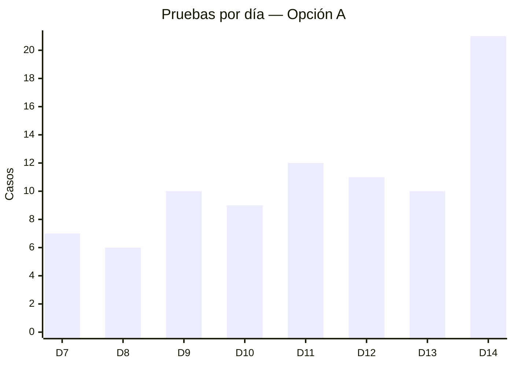
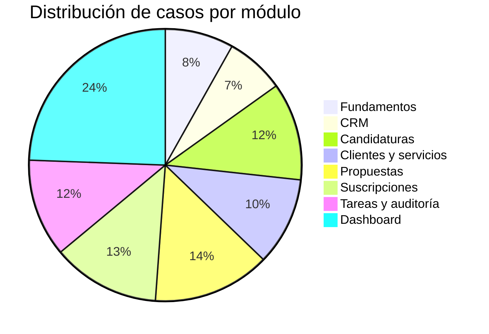

# Opción A — Escenario integrado completo

Dataset sintético cargado en `fluxis_test` para el usuario **Synthetic Integration User** (`integration@fluxis.local`). Conecta todos los módulos de los días 7–14 en un único escenario coherente y permite validar el dashboard con datos reales.

> Este documento se generó a partir del resultado real de `option-a-verify.sql` ejecutado el **2026-11-17** contra el entorno TEST. No contiene contraseñas y no debe ejecutarse contra producción.

## Resumen ejecutivo

| Indicador | Valor |
|---|---:|
| Registros creados | 75 |
| Casos verificados | 86 |
| Cumplen | 84 |
| Fallan | 0 |
| Pendientes de revisión visual | 2 |
| Cobertura de casos ejecutados | 100,0 % |
| Cobertura sobre el total | 97,7 % |

Los dos casos pendientes son comprobaciones visuales en el navegador; todas las comprobaciones automatizadas de datos, cálculos, historial, auditoría y métricas del dashboard cumplen.

## Alcance

La Opción A crea un escenario integrado con:

- empresas y contactos, incluido un contacto independiente sin empresa;
- oportunidades laborales, candidaturas, entrevistas y seguimientos;
- clientes en los estados `POTENCIAL`, `ACTIVE`, `INACTIVE` y `LOST`;
- servicios por hora, fijos y recurrentes, con servicios activos e inactivos;
- propuestas con ítems, importes `NUMERIC` e historial de cambios;
- suscripciones activas y canceladas en EUR y USD;
- tareas vinculadas a clientes, propuestas, suscripciones y candidaturas, más una tarea manual;
- eventos de auditoría con detalle JSON;
- datos suficientes para calcular métricas y margen por moneda sin mezclar divisas.

Se complementa con las otras opciones: la Opción B valida el flujo autenticado de la API y la Opción C ofrece un dataset visual; la Opción A conecta todos los módulos entre sí y sirve como base de verificación del dashboard.

## Requisitos

- Backend y PostgreSQL del entorno TEST en ejecución (`env-test` y `postgres-test`).
- Usuario `integration@fluxis.local` ya creado en `fluxis_test`.
- PowerShell con Docker disponible.

El script no crea usuarios, no cambia contraseñas y no modifica migraciones, imágenes ni volúmenes.

## Ejecución

Desde la raíz del repositorio, con la contraseña local del entorno TEST en `PGPASSWORD`:

```powershell
$env:PGPASSWORD = '<local-test-password>'
Get-Content .\scripts\test-data\option-a-integrated.sql -Raw |
  docker exec -i -e PGPASSWORD=$env:PGPASSWORD postgres-test psql -U fluxis_test -d fluxis_test -v ON_ERROR_STOP=1
```

El script es idempotente: usa UUID deterministas y `ON CONFLICT (id) DO NOTHING`, por lo que repetirlo no duplica registros.

## Verificación

```powershell
$env:PGPASSWORD = '<local-test-password>'
Get-Content .\scripts\test-data\option-a-verify.sql -Raw |
  docker exec -i -e PGPASSWORD=$env:PGPASSWORD postgres-test psql -U fluxis_test -d fluxis_test -v ON_ERROR_STOP=1
```

La verificación es de solo lectura. Aplica las mismas reglas que `DashboardService`: suma ingresos aceptados por divisa, normaliza suscripciones a coste mensual/anual, calcula margen por moneda y cuenta tareas pendientes, en progreso, completadas y vencidas.

## Datos creados

| Entidad | Registros | Día(s) | Propietario |
|---|---:|---|---|
| `companies` | 4 | 8 | `integration@fluxis.local` |
| `contacts` | 5 | 8 | `integration@fluxis.local` |
| `job_opportunities` | 4 | 7, 9 | `integration@fluxis.local` |
| `job_applications` | 3 | 9 | `integration@fluxis.local` |
| `application_interviews` | 4 | 9 | `integration@fluxis.local` |
| `application_follow_ups` | 3 | 9 | `integration@fluxis.local` |
| `clients` | 4 | 10 | `integration@fluxis.local` |
| `services` | 5 | 10 | `integration@fluxis.local` |
| `proposals` | 4 | 11 | `integration@fluxis.local` |
| `proposal_items` | 6 | 11 | `integration@fluxis.local` |
| `proposal_history` | 9 | 11 | `integration@fluxis.local` |
| `subscriptions` | 6 | 12 | `integration@fluxis.local` |
| `tasks` | 8 | 13 | `integration@fluxis.local` |
| `audit_events` | 10 | 13 | `integration@fluxis.local` |
| **Total** | **75** | 7–13 | `integration@fluxis.local` |

El día 14 no crea entidades: consume las anteriores para calcular las métricas del dashboard.

## Casos y resultados

Todos los casos pertenecen a `integration@fluxis.local`. La columna **Resultado** usa `Cumple`, `Falla` o `Pendiente`.

### Día 7 — Fundamentos

| Módulo | Caso | Propietario | Esperado | Obtenido | Resultado |
|---|---|---|---|---|---|
| Fundamentos | Base applications visible | `integration@fluxis.local` | `3` | `3` | **Cumple** |
| Fundamentos | Base companies visible | `integration@fluxis.local` | `4` | `4` | **Cumple** |
| Fundamentos | Base contacts visible | `integration@fluxis.local` | `5` | `5` | **Cumple** |
| Fundamentos | Base opportunities visible | `integration@fluxis.local` | `4` | `4` | **Cumple** |
| Fundamentos | Flyway migrations V1-V11 applied successfully | `integration@fluxis.local` | `11` | `11` | **Cumple** |
| Fundamentos | No Option A row is assigned to another user | `integration@fluxis.local` | `0` | `0` | **Cumple** |
| Fundamentos | Synthetic Integration User exists exactly once | `integration@fluxis.local` | `1` | `1` | **Cumple** |

### Día 8 — CRM

| Módulo | Caso | Propietario | Esperado | Obtenido | Resultado |
|---|---|---|---|---|---|
| CRM | Companies created | `integration@fluxis.local` | `4` | `4` | **Cumple** |
| CRM | Contacts created | `integration@fluxis.local` | `5` | `5` | **Cumple** |
| CRM | Contacts linked to a company | `integration@fluxis.local` | `4` | `4` | **Cumple** |
| CRM | Independent contact without company | `integration@fluxis.local` | `1` | `1` | **Cumple** |
| CRM | No duplicate company names | `integration@fluxis.local` | `0` | `0` | **Cumple** |
| CRM | No duplicate contact emails | `integration@fluxis.local` | `0` | `0` | **Cumple** |

### Día 9 — Candidaturas

| Módulo | Caso | Propietario | Esperado | Obtenido | Resultado |
|---|---|---|---|---|---|
| Candidaturas | Application status distribution | `integration@fluxis.local` | `INTERVIEW=1, OFFER_RECEIVED=1, REJECTED=1` | `INTERVIEW=1, OFFER_RECEIVED=1, REJECTED=1` | **Cumple** |
| Candidaturas | Applications created | `integration@fluxis.local` | `3` | `3` | **Cumple** |
| Candidaturas | Completed follow-up | `integration@fluxis.local` | `1` | `1` | **Cumple** |
| Candidaturas | Distinct opportunity statuses | `integration@fluxis.local` | `4` | `4` | **Cumple** |
| Candidaturas | Follow-ups registered | `integration@fluxis.local` | `3` | `3` | **Cumple** |
| Candidaturas | Future interviews | `integration@fluxis.local` | `2` | `2` | **Cumple** |
| Candidaturas | Interviews registered | `integration@fluxis.local` | `4` | `4` | **Cumple** |
| Candidaturas | One application per opportunity | `integration@fluxis.local` | `3` | `3` | **Cumple** |
| Candidaturas | Open overdue follow-up | `integration@fluxis.local` | `1` | `1` | **Cumple** |
| Candidaturas | Opportunities in the application flow | `integration@fluxis.local` | `4` | `4` | **Cumple** |

### Día 10 — Clientes y servicios

| Módulo | Caso | Propietario | Esperado | Obtenido | Resultado |
|---|---|---|---|---|---|
| Clientes y servicios | Active services | `integration@fluxis.local` | `4` | `4` | **Cumple** |
| Clientes y servicios | Client status distribution | `integration@fluxis.local` | `POTENCIAL=1, ACTIVE=1, INACTIVE=1, LOST=1` | `POTENCIAL=1, ACTIVE=1, INACTIVE=1, LOST=1` | **Cumple** |
| Clientes y servicios | Clients created | `integration@fluxis.local` | `4` | `4` | **Cumple** |
| Clientes y servicios | Clients linked to company and contact | `integration@fluxis.local` | `4` | `4` | **Cumple** |
| Clientes y servicios | Inactive services | `integration@fluxis.local` | `1` | `1` | **Cumple** |
| Clientes y servicios | Positive service rates | `integration@fluxis.local` | `5` | `5` | **Cumple** |
| Clientes y servicios | Pricing model distribution | `integration@fluxis.local` | `HOURLY=2, FIXED=2, RECURRING=1` | `HOURLY=2, FIXED=2, RECURRING=1` | **Cumple** |
| Clientes y servicios | Service currency count | `integration@fluxis.local` | `2` | `2` | **Cumple** |
| Clientes y servicios | Services created | `integration@fluxis.local` | `5` | `5` | **Cumple** |

### Día 11 — Propuestas

| Módulo | Caso | Propietario | Esperado | Obtenido | Resultado |
|---|---|---|---|---|---|
| Propuestas | Accepted revenue in EUR | `integration@fluxis.local` | `3700.00` | `3700.00` | **Cumple** |
| Propuestas | Accepted revenue in USD | `integration@fluxis.local` | `3500.00` | `3500.00` | **Cumple** |
| Propuestas | Amount equals quantity x unit price | `integration@fluxis.local` | `0` | `0` | **Cumple** |
| Propuestas | History change types | `integration@fluxis.local` | `CREATED=4, UPDATED=5` | `CREATED=4, UPDATED=5` | **Cumple** |
| Propuestas | Latest history total matches proposal total | `integration@fluxis.local` | `0` | `0` | **Cumple** |
| Propuestas | Proposal history records | `integration@fluxis.local` | `9` | `9` | **Cumple** |
| Propuestas | Proposal items created | `integration@fluxis.local` | `6` | `6` | **Cumple** |
| Propuestas | Proposal status distribution | `integration@fluxis.local` | `ACCEPTED=2, REJECTED=1, SENT=1` | `ACCEPTED=2, REJECTED=1, SENT=1` | **Cumple** |
| Propuestas | Proposals created | `integration@fluxis.local` | `4` | `4` | **Cumple** |
| Propuestas | Proposals with history | `integration@fluxis.local` | `4` | `4` | **Cumple** |
| Propuestas | Subtotal equals sum of items | `integration@fluxis.local` | `0` | `0` | **Cumple** |
| Propuestas | Total equals subtotal | `integration@fluxis.local` | `0` | `0` | **Cumple** |

### Día 12 — Suscripciones

| Módulo | Caso | Propietario | Esperado | Obtenido | Resultado |
|---|---|---|---|---|---|
| Suscripciones | Active periodicity distribution | `integration@fluxis.local` | `MONTHLY=3, QUARTERLY=1, YEARLY=1` | `MONTHLY=3, QUARTERLY=1, YEARLY=1` | **Cumple** |
| Suscripciones | Active subscription currencies | `integration@fluxis.local` | `2` | `2` | **Cumple** |
| Suscripciones | Active subscriptions | `integration@fluxis.local` | `5` | `5` | **Cumple** |
| Suscripciones | Active subscriptions with renewal date | `integration@fluxis.local` | `5` | `5` | **Cumple** |
| Suscripciones | Annual subscription cost in EUR | `integration@fluxis.local` | `1920.00` | `1920.00` | **Cumple** |
| Suscripciones | Annual subscription cost in USD | `integration@fluxis.local` | `42720.00` | `42720.00` | **Cumple** |
| Suscripciones | Cancelled subscriptions | `integration@fluxis.local` | `1` | `1` | **Cumple** |
| Suscripciones | Monthly subscription cost in EUR | `integration@fluxis.local` | `160.00` | `160.00` | **Cumple** |
| Suscripciones | Monthly subscription cost in USD | `integration@fluxis.local` | `3560.00` | `3560.00` | **Cumple** |
| Suscripciones | Renewals within 30 days | `integration@fluxis.local` | `4` | `4` | **Cumple** |
| Suscripciones | Subscriptions created | `integration@fluxis.local` | `6` | `6` | **Cumple** |

### Día 13 — Tareas y auditoría

| Módulo | Caso | Propietario | Esperado | Obtenido | Resultado |
|---|---|---|---|---|---|
| Tareas y auditoría | Audit events created | `integration@fluxis.local` | `10` | `10` | **Cumple** |
| Tareas y auditoría | Audit events with JSON details | `integration@fluxis.local` | `10` | `10` | **Cumple** |
| Tareas y auditoría | Audit events without an existing entity | `integration@fluxis.local` | `0` | `0` | **Cumple** |
| Tareas y auditoría | Audited actions | `integration@fluxis.local` | `2` | `2` | **Cumple** |
| Tareas y auditoría | Audited entity types | `integration@fluxis.local` | `4` | `4` | **Cumple** |
| Tareas y auditoría | Manual tasks without link | `integration@fluxis.local` | `1` | `1` | **Cumple** |
| Tareas y auditoría | Overdue tasks | `integration@fluxis.local` | `2` | `2` | **Cumple** |
| Tareas y auditoría | Task status distribution | `integration@fluxis.local` | `TODO=4, IN_PROGRESS=1, DONE=2, CANCELLED=1` | `TODO=4, IN_PROGRESS=1, DONE=2, CANCELLED=1` | **Cumple** |
| Tareas y auditoría | Tasks created | `integration@fluxis.local` | `8` | `8` | **Cumple** |
| Tareas y auditoría | Tasks linked to other entities | `integration@fluxis.local` | `7` | `7` | **Cumple** |

### Día 14 — Dashboard

| Módulo | Caso | Propietario | Esperado | Obtenido | Resultado |
|---|---|---|---|---|---|
| Dashboard | Dashboard page shows the integrated metrics | `integration@fluxis.local` | `Visible in UI` | `Pending manual verification` | **Pendiente** |
| Dashboard | Margin in EUR | `integration@fluxis.local` | `3540.00` | `3540.00` | **Cumple** |
| Dashboard | Margin in USD | `integration@fluxis.local` | `-60.00` | `-60.00` | **Cumple** |
| Dashboard | Margins grouped by currency | `integration@fluxis.local` | `2` | `2` | **Cumple** |
| Dashboard | Module navigation works with the integrated data | `integration@fluxis.local` | `Visible in UI` | `Pending manual verification` | **Pendiente** |
| Dashboard | acceptedByCurrency has one entry per currency | `integration@fluxis.local` | `2` | `2` | **Cumple** |
| Dashboard | annualByCurrency has one entry per currency | `integration@fluxis.local` | `2` | `2` | **Cumple** |
| Dashboard | clients.active | `integration@fluxis.local` | `1` | `1` | **Cumple** |
| Dashboard | clients.potential | `integration@fluxis.local` | `1` | `1` | **Cumple** |
| Dashboard | clients.total | `integration@fluxis.local` | `4` | `4` | **Cumple** |
| Dashboard | monthlyByCurrency has one entry per currency | `integration@fluxis.local` | `2` | `2` | **Cumple** |
| Dashboard | proposals.total | `integration@fluxis.local` | `4` | `4` | **Cumple** |
| Dashboard | services.active | `integration@fluxis.local` | `4` | `4` | **Cumple** |
| Dashboard | services.total | `integration@fluxis.local` | `5` | `5` | **Cumple** |
| Dashboard | subscriptions.active | `integration@fluxis.local` | `5` | `5` | **Cumple** |
| Dashboard | subscriptions.upcomingRenewals | `integration@fluxis.local` | `4` | `4` | **Cumple** |
| Dashboard | tasks.done | `integration@fluxis.local` | `2` | `2` | **Cumple** |
| Dashboard | tasks.inProgress | `integration@fluxis.local` | `1` | `1` | **Cumple** |
| Dashboard | tasks.overdue | `integration@fluxis.local` | `2` | `2` | **Cumple** |
| Dashboard | tasks.pending | `integration@fluxis.local` | `4` | `4` | **Cumple** |
| Dashboard | tasks.total | `integration@fluxis.local` | `8` | `8` | **Cumple** |

## Cumplimiento por día

| Día | Pruebas | Cumplen | Fallan | Pendientes | Cobertura ejecutada | Cobertura total |
|---|---:|---:|---:|---:|---:|---:|
| 7 | 7 | 7 | 0 | 0 | 100,0 % | 100,0 % |
| 8 | 6 | 6 | 0 | 0 | 100,0 % | 100,0 % |
| 9 | 10 | 10 | 0 | 0 | 100,0 % | 100,0 % |
| 10 | 9 | 9 | 0 | 0 | 100,0 % | 100,0 % |
| 11 | 12 | 12 | 0 | 0 | 100,0 % | 100,0 % |
| 12 | 11 | 11 | 0 | 0 | 100,0 % | 100,0 % |
| 13 | 10 | 10 | 0 | 0 | 100,0 % | 100,0 % |
| 14 | 21 | 19 | 0 | 2 | 100,0 % | 90,5 % |
| **Total** | **86** | **84** | **0** | **2** | **100,0 %** | **97,7 %** |

`Cobertura ejecutada = cumplen / (cumplen + fallan)`. `Cobertura total = cumplen / pruebas`.



## Distribución por módulo

| Módulo | Casos | Porcentaje |
|---|---:|---:|
| Fundamentos | 7 | 8,1 % |
| CRM | 6 | 7,0 % |
| Candidaturas | 10 | 11,6 % |
| Clientes y servicios | 9 | 10,5 % |
| Propuestas | 12 | 14,0 % |
| Suscripciones | 11 | 12,8 % |
| Tareas y auditoría | 10 | 11,6 % |
| Dashboard | 21 | 24,4 % |
| **Total** | **86** | **100,0 %** |



## Resumen monetario sin mezclar monedas

### Ingresos aceptados y coste normalizado

| Divisa | Ingresos aceptados | Coste mensual | Coste anual | Margen mensual |
|---|---:|---:|---:|---:|
| EUR | 3700,00 | 160,00 | 1920,00 | 3540,00 |
| USD | 3500,00 | 3560,00 | 42720,00 | -60,00 |

El margen se calcula como `ingresos aceptados - coste mensual normalizado`, siempre dentro de la misma divisa. **No se suman EUR y USD en ningún total.**

### Detalle del coste mensual

| Divisa | Suscripción | Importe | Normalización mensual |
|---|---|---:|---:|
| EUR | Cloud hosting | 120,00 mensual | 120,00 |
| EUR | Design suite | 480,00 anual | 40,00 |
| USD | Observability | 300,00 mensual | 300,00 |
| USD | Email platform | 180,00 trimestral | 60,00 |
| USD | Data warehouse | 3200,00 mensual | 3200,00 |

La suscripción `Legacy fax` (USD, 25,00 mensual) está `CANCELLED` y queda excluida de los totales activos. El coste anual se obtiene multiplicando cada suscripción activa por su periodicidad (mensual × 12, trimestral × 4, anual × 1).

## Dashboard esperado

### Métricas aisladas de la Opción A

| Bloque | Valores |
|---|---|
| `clients` | total 4 · potential 1 · active 1 |
| `services` | total 5 · active 4 |
| `proposals` | total 4 · ACCEPTED 2 · REJECTED 1 · SENT 1 |
| `proposals.acceptedByCurrency` | EUR 3700,00 · USD 3500,00 |
| `subscriptions` | active 5 · upcomingRenewals 4 |
| `subscriptions.monthlyByCurrency` | EUR 160,00 · USD 3560,00 |
| `subscriptions.annualByCurrency` | EUR 1920,00 · USD 42720,00 |
| `tasks` | total 8 · pending 4 · inProgress 1 · done 2 · overdue 2 |
| `margins` | EUR: 3700,00 − 160,00 = 3540,00 · USD: 3500,00 − 3560,00 = -60,00 |

### Vista combinada del usuario

Mientras las Opciones B y C sigan cargadas para el mismo usuario, el dashboard suma también sus registros. Estos son los valores que muestra la UI en ese estado:

| Métrica | Valor |
|---|---:|
| Clientes | 9 (3 potenciales, 2 activos) |
| Servicios | 10 (8 activos) |
| Propuestas | 8 |
| Suscripciones activas | 9 |
| Coste mensual EUR | 364,90 |
| Coste mensual USD | 3580,00 |
| Coste anual EUR | 4378,80 |
| Coste anual USD | 42960,00 |
| Renovaciones próximas (30 días) | 7 |
| Tareas | 15 (8 pendientes, 2 en progreso, 3 completadas, 3 vencidas) |
| Ingresos aceptados EUR | 6200,00 |
| Ingresos aceptados USD | 5300,00 |
| Margen EUR | 5835,10 |
| Margen USD | 1720,00 |

Si se limpian las Opciones B y C, la UI debe mostrar exactamente las métricas aisladas de la tabla anterior.

## Pendiente de verificación manual

| Caso | Cómo verificar | Resultado esperado |
|---|---|---|
| Dashboard page shows the integrated metrics | Abrir el frontend TEST en `http://localhost:5174`, iniciar sesión y revisar `/dashboard` | Métricas combinadas de la tabla anterior, con EUR y USD separados |
| Module navigation works with the integrated data | Recorrer oportunidades, CRM, candidaturas, clientes y servicios, propuestas, suscripciones y tareas | Los registros de la Opción A aparecen y los enlaces entre módulos son coherentes |

Pasos sugeridos:

```powershell
cd frontend
npm run dev:test
```

Después de confirmar ambos casos, actualizar esta tabla de `Pendiente` a `Cumple`.

## Idempotencia y limpieza

- Volver a ejecutar `option-a-integrated.sql` reutiliza los mismos UUID y no duplica datos.
- Para eliminar solo la Opción A sin tocar las Opciones B y C:

```powershell
$env:PGPASSWORD = '<local-test-password>'
Get-Content .\scripts\test-data\option-a-cleanup.sql -Raw |
  docker exec -i -e PGPASSWORD=$env:PGPASSWORD postgres-test psql -U fluxis_test -d fluxis_test -v ON_ERROR_STOP=1
```

- La limpieza respeta el orden de dependencias: propuestas antes que clientes y servicios, candidaturas antes que oportunidades, contactos antes que empresas.

## Archivos

- Dataset: [`scripts/test-data/option-a-integrated.sql`](../scripts/test-data/option-a-integrated.sql)
- Verificación: [`scripts/test-data/option-a-verify.sql`](../scripts/test-data/option-a-verify.sql)
- Limpieza: [`scripts/test-data/option-a-cleanup.sql`](../scripts/test-data/option-a-cleanup.sql)
