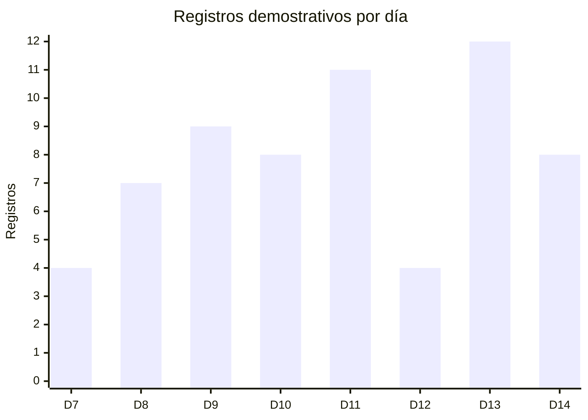
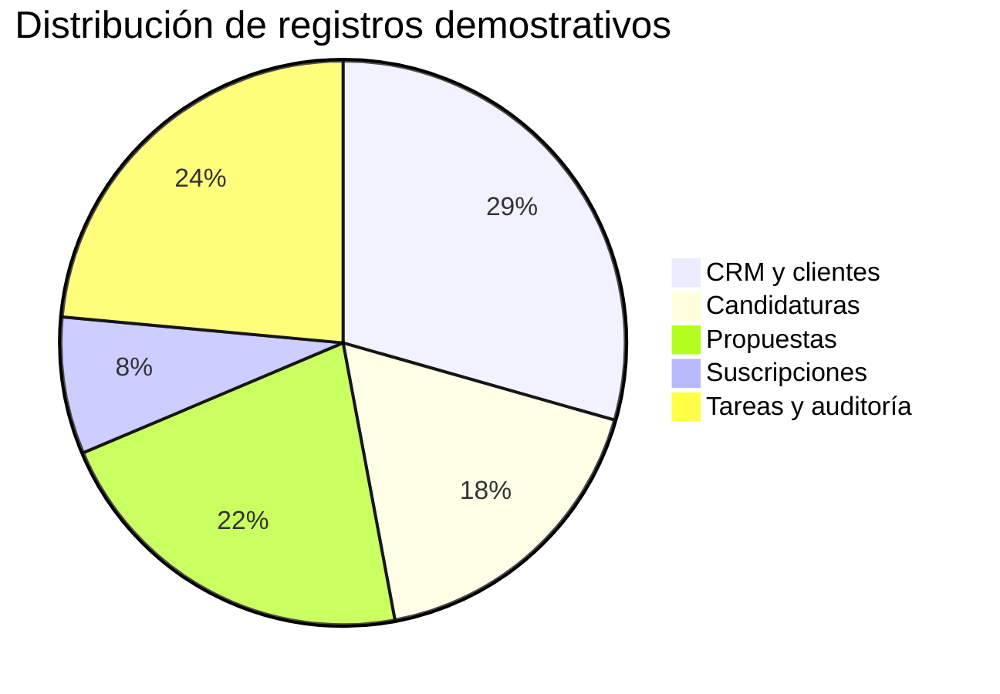

# Opción C — Dataset demostrativo de integración

Este dataset está diseñado para mostrar el sistema con datos sintéticos del usuario `Synthetic Integration User` en `fluxis_test`. No contiene contraseñas y debe ejecutarse únicamente en el ambiente test.

Script: [`scripts/test-data/option-c-demo.sql`](../scripts/test-data/option-c-demo.sql)

## Casos visibles por día

| Día | Área | Registros demostrativos |
|---|---|---:|
| 7 | Oportunidades base | 4 |
| 8 | Empresas y contactos | 7 |
| 9 | Candidaturas, entrevistas y seguimientos | 9 |
| 10 | Clientes y servicios | 8 |
| 11 | Propuestas, ítems e historial | 11 |
| 12 | Suscripciones | 4 |
| 13 | Tareas y auditoría | 12 |
| 14 | Métricas del dashboard | 8 |

## Escenarios de demostración

| Escenario | Resultado esperado |
|---|---|
| Cliente `POTENCIAL` y cliente `ACTIVE` | Se distinguen en clientes y dashboard |
| Propuestas aceptadas EUR y USD | El dashboard mantiene monedas separadas |
| Suscripciones mensuales y anuales | El gasto mensual/anual se calcula con dos decimales |
| Tarea vencida vinculada a una candidatura | Aparece como vencida y relacionada |
| Historial de propuesta | Se observan cambios `CREATED` y `UPDATED` |
| Auditoría de tareas | Se observan eventos de creación y actualización |
| Margen EUR y USD | Se calcula por moneda sin conversiones |

## Cobertura visual

La cobertura de pruebas automatizadas se reporta por separado; este documento mide los casos sintéticos disponibles para validación manual y demostración.
